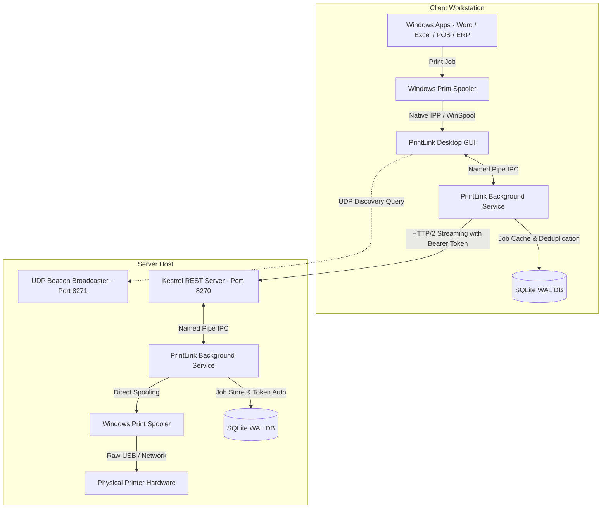

# L-Net PrintLink 🖨️🚀

[](https://github.com/jacob157-rgb/PrintLink/actions/workflows/release.yml)
[](https://github.com/jacob157-rgb/PrintLink/actions/workflows/ci.yml)
[](https://dotnet.microsoft.com/)
[-blue.svg)](https://microsoft.com/windows)
[](https://github.com/jacob157-rgb/PrintLink/releases)
[]()

**L-Net PrintLink** adalah platform enterprise modern untuk berbagi printer Windows (*printer sharing*) dan menjamin keandalan koneksi cetak jaringan lokal (LAN). PrintLink menggantikan printer sharing jadul Windows SMB/RPC yang sering error, lambat, atau terputus dengan arsitektur client-server modern yang tangguh, terenkripsi, terautentikasi, otomatis sinkronisasi driver & ukuran kertas custom (Surat Jalan, faktur, kasir), serta dilengkapi *self-healing reconnect*.

---

## 🌟 Fitur Utama (Key Features)

### 1. 🔄 Driver Package & Custom Paper Forms Sync (Server ➔ Client)
- **Ekstraksi & Distribusi Driver Otomatis**: Server mengompresi driver dari `DriverStore` Windows dan client menginstalnya secara otomatis menggunakan `pnputil.exe` dan `Add-PrinterDriver`. Pengguna di client tidak perlu mencari dan menginstal CD/driver secara manual!
- **Injeksi Ukuran Kertas Custom (`winspool.drv!AddFormW`)**: Seluruh ukuran form custom di server (seperti kertas Continuous Form Surat Jalan, faktur pajak, struk POS/kasir, atau label barcode) langsung didaftarkan ke Windows Print Spooler client. Form langsung muncul di aplikasi Windows (Word, Excel, browser Chrome, Accurate, SAP, POS/ERP).

### 2. 🎨 Modern Fluent Dark UI & Responsive Scaling
- Tampilan antarmuka modern terinspirasi Windows 11 dengan palet Slate gelap (`#0F172A`).
- Tata letak multi-baris dinamis (*responsive multi-row cards*) yang tidak saling menimpa atau terpotong pada berbagai resolusi layar (laptop 1366×768 hingga monitor 4K) dan scaling Windows (100%, 125%, 150%).
- Dialog pop-up konfirmasi modern dengan sudut melengkung, ikon badge SVG berwarna, dan navigasi keyboard (Enter = Ya/OK, Esc = Batal).

### 3. 🌐 Status Bar Network Identity & Refresh All + Auto LAN Scan
- **IP Address Display (Kiri Bawah)**: Menampilkan IP lokal mesin dan IP server tujuan secara jelas di pojok kiri bawah (`🖥️ Server IP: 192.168.1.100:8270` atau `💻 Client IP: 192.168.1.45`), memudahkan staf IT dan pengguna melihat konfigurasi jaringan.
- **Refresh All Otomatis Scan LAN**: Tombol *Refresh All* memindai seluruh status printer lokal, service spooler, jobs antrean, sekaligus mengeksekusi *Auto LAN Discovery* via UDP broadcast untuk menemukan printer yang dibagikan di jaringan lokal.

### 4. 🗑️ Revoke & Delete Client Access
- Manajemen token otorisasi klien yang aman berbasis hash SHA-256.
- Tombol **Hapus / Revoke** dapat mencabut hak akses sekaligus menghapus kredensial klien secara permanen dari database SQLite dan memori server dengan konfirmasi pop-up modern.

### 5. 🚀 Standalone Installer & Launch at Login Wizard
- **100% Self-Contained Single-File Installer**: File instalasi berukuran ~194 MB yang memaketkan seluruh runtime .NET dan aplikasi tanpa perlu buka-tutup installer berulang kali untuk mengunduh runtime secara manual.
- **Penawaran Launch at Login**: Setelah instalasi selesai, installer secara interaktif menawarkan opsi *Launch at Login* (jalan otomatis saat Windows booting), sangat direkomendasikan agar printer jaringan selalu siap sedia.

### 6. 🔄 OTA Auto-Update via GitHub
- Fitur pembaruan sistem *Over-The-Air* (OTA) yang mengecek rilis terbaru dari repositori GitHub [`jacob157-rgb/PrintLink`](https://github.com/jacob157-rgb/PrintLink/releases).
- Notifikasi versi baru lengkap dengan catatan rilis, tombol unduh otomatis, dan instalasi pembaruan sekali klik.

---

## 🎯 3 Mode Operasional (Operating Modes)

| Mode | Fungsi Utama |
| :--- | :--- |
| **🖥️ Server** | Mempublikasikan printer lokal Windows ke jaringan LAN dengan nama friendly, menerima antrean cetak via REST API, dan mengelola paket driver serta form ukuran kertas. |
| **💻 Client** | Memindai server di jaringan LAN, mengunduh driver & ukuran kertas custom dari server, mendaftarkan printer jaringan ke Windows, dan mengirim dokumen cetak. |
| **🔄 Combined** | Menjalankan fungsi Server dan Client secara bersamaan pada satu komputer (ideal untuk cabang kantor yang saling berbagi printer). |

---

## 🏗️ Arsitektur Sistem (Topology)



---

## 🛠️ Tech Stack

- **Framework & Bahasa:** C# 14 / .NET 10 LTS (`net10.0-windows`)
- **Desktop UI:** Windows Presentation Foundation (WPF), Segoe UI Variable, Fluent Dark Architecture
- **Background Engine:** Windows Service (`Microsoft.Extensions.Hosting.WindowsServices`)
- **Jaringan & REST API:** ASP.NET Core Kestrel (Streaming endpoint, Bearer Token Auth, Rate Limiter)
- **Spooler Engine:** Win32 Native APIs via P/Invoke (`winspool.drv` - `OpenPrinter`, `StartDocPrinter`, `WritePrinter`, `AddFormW`, `EnumForms`)
- **Database Lokal:** SQLite (`Microsoft.Data.Sqlite`) mode WAL dengan auto-migrasi skema
- **Packaging:** Self-Contained Single-File Installer (`PrintLink.Setup`)

---

## 🚀 Cara Build & Menginstal

### Persyaratan:
- Windows 10 (1809+) atau Windows 11 (64-bit)
- .NET 10 SDK (hanya diperlukan bagi pengembang yang ingin me-rebuild source code)

### Menjalankan Unit Tests:
```powershell
dotnet test
```

### Membangun Installer Standalone:
Jalankan script PowerShell bawaan di root proyek:
```powershell
powershell -ExecutionPolicy Bypass -File installer/Build-Installer.ps1 -Configuration Release
```
Output installer akan tersimpan di:
`installer/output/PrintLink-Setup-v1.0.0.exe` (~194 MB)

---

## 📦 GitHub Actions CI/CD & Auto Release

Repositori ini telah dilengkapi pipeline otomatisasi GitHub Actions:

- **Continuous Integration (`.github/workflows/ci.yml`)**: Otomatis menjalankan unit testing pada setiap `push` dan `pull_request`.
- **Auto Release Workflow (`.github/workflows/release.yml`)**:
  - Dijalankan secara otomatis saat git tag versi di-push (contoh: `git tag v1.0.0 && git push origin v1.0.0`).
  - Dapat juga dijalankan secara manual melalui tab **Actions ➔ Build & Release ➔ Run workflow**.
  - Pipeline akan otomatis mengompilasi paket installer standalone, membuat entri **GitHub Release**, dan mengunggah binary `PrintLink-Setup-*.exe` langsung ke halaman Releases GitHub!

---

## 📄 Lisensi
Hak Cipta © 2026 Jacob / L-Net PrintLink. Seluruh hak cipta dilindungi undang-undang.
