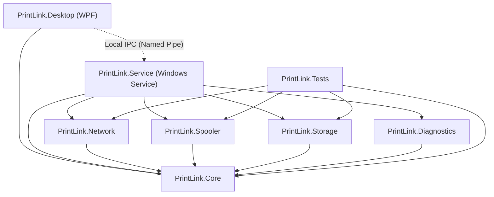
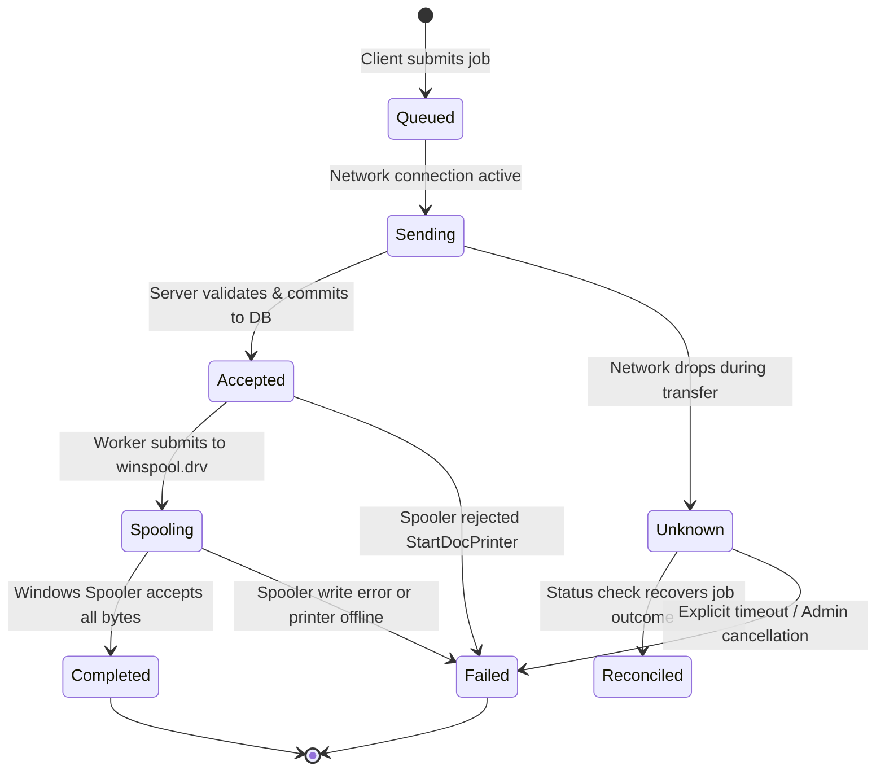

# Architecture & Technical Design Document

## L-Net PrintLink — Windows Printer Sharing & Reliability

- **Version:** v1.0.0
- **Status:** Approved Architecture Specification
- **Target OS:** Windows 10 (19041+) / Windows 11 (21H2+)
- **Framework:** .NET 10 LTS (`net10.0-windows`), C# 14
- **Date:** 26 October 2026

---

## 1. Executive Summary & Architectural Goals

The primary goal of **L-Net PrintLink** is to deliver resilient, observable, and authenticated printer sharing across Windows computers without relying on legacy Windows SMB printer sharing or fragile RPC-based "Point and Print" configurations.

### Architectural Core Directives
1. **Separation of Concerns:** The printing, networking, and spooling logic resides entirely in a background **Windows Service** (`PrintLink.Service`), running independently of the user session and desktop GUI (`PrintLink.Desktop`).
2. **Proof-Before-Claim:** No assumptions regarding universal printing compatibility. The printing pipeline must be verified via step-by-step Proof of Concept (PoC) using concrete Windows APIs (`winspool.drv`).
3. **No Kernel Drivers:** Custom kernel drivers are strictly out of scope. PrintLink leverages in-box Microsoft printer class drivers and native user-mode spooler APIs.
4. **Idempotent Job Lifecycle:** Every job carries a stable, client-generated Job ID (`UUIDv7`) with deterministic state tracking (`Queued`, `Sending`, `Accepted`, `Spooling`, `Completed`, `Failed`, `Unknown`).
5. **Security by Default:** All remote communications use TLS 1.3/1.2; authentication is enforced per-client and per-printer; zero plaintext secrets.

---

## 2. High-Level Modular Solution Structure

The Visual Studio Solution `LNet.PrintLink.sln` is organized into clean, single-responsibility modules:

```text
LNet.PrintLink/
├── src/
│   ├── PrintLink.Core/           # Domain models, enums (JobState), interfaces, configuration models
│   ├── PrintLink.Storage/        # SQLite persistence (WAL mode), migrations, repository pattern
│   ├── PrintLink.Spooler/        # Windows Spooler integration (winspool.drv P/Invoke, printer enumeration)
│   ├── PrintLink.Network/        # Kestrel HTTP/3 & HTTP/2 server, TLS management, HTTP client, Reconnect engine
│   ├── PrintLink.Diagnostics/    # Structured Serilog sinks, diagnostic bundle exporter, reference ID generator
│   ├── PrintLink.Service/        # .NET Worker Service, Windows Service lifecycle, IPC Server, orchestrator
│   └── PrintLink.Desktop/        # WPF Modern GUI, MVVM architecture, System Tray controller, IPC Client
├── tests/
│   └── PrintLink.Tests/          # Unit tests (state machine, backoff logic, auth validation, serialization)
└── docs/
    ├── PRD.md                    # Product requirements
    ├── ARCHITECTURE.md           # This document
    ├── SECURITY.md               # Threat modeling, security controls, DPAPI, firewall
    └── POC_PLAN.md               # Step-by-step 2-PC validation plan
```

### Module Dependency Graph



---

## 3. Comprehensive Analysis of Windows Remote Printing Approaches

To achieve printing from standard Windows applications (e.g., Microsoft Word, Notepad, Edge, Acrobat, and retail POS apps) without kernel drivers, we evaluate three primary architectural approaches:


### 3.1 Approach 1: Native Windows IPP (Internet Printing Protocol over HTTPS)
- **Mechanisms:**
  Windows 10 (19041+) and Windows 11 include a native IPP client and the **"Microsoft IPP Class Driver"**. A user or script can add a printer via `Add-Printer -PortName "https://server:8270/printers/ShareName"`. PrintLink's background service hosts an embedded IPP 2.0 responder using ASP.NET Core Kestrel.
- **Strengths:**
  - Standard Windows print dialog works transparently.
  - Driverless on client side (Windows renders internally to PWG-Raster, Apple Raster, or PDF via the IPP class driver).
  - No custom client print driver or port monitor needed.
- **Limitations & Pitfalls:**
  - Windows IPP client strictly checks TLS certificates. If a self-signed certificate is used without installing the root CA into the Client machine's `LocalMachine\Root` store, Windows silently fails to add or print.
  - Authentication in Windows Add-Printer wizard for IPP has legacy HTTP Basic/Digest quirks and does not support modern token/header auth.
  - Thermal / ESC/POS raw data is difficult to route through IPP standard page-raster pipelines.

### 3.2 Approach 2: Windows Native SMB / RPC Print Sharing
- **Mechanisms:**
  Traditional Windows `\\server\share` printing via `spoolsv.exe`.
- **Strengths:**
  - Built into Windows.
- **Limitations & Pitfalls:**
  - This is the exact pain point PrintLink was designed to eliminate. Since Windows PrintNightmare patches, non-admin users cannot install remote drivers without registry hacks (`RestrictDriverInstallationToAdministrators = 0`).
  - Frequent RPC errors (`0x0000011b`, `0x00000709`).
  - Lacks fine-grained per-client token authorization, persistent client-side job lifecycle, or structured telemetry.
- **Verdict for PrintLink:** Rejected as primary transport.

### 3.3 Approach 3: PrintLink Agent-to-Agent Custom Pipeline
- **Mechanisms:**
  Both Server and Client run `PrintLink.Service`. The Client machine provisions a local printer queue using standard in-box Microsoft drivers (e.g., *Microsoft Print to PDF*, *Generic / Text Only*, or *Microsoft Software Printer Driver*). The PrintLink Client captures the spool output (via a dedicated virtual port monitor or loopback socket) and streams the document over a custom TLS 1.3 REST/gRPC API directly to the PrintLink Server. The Server directly injects the bytes into the target physical printer via Windows Spooler APIs (`winspool.drv`).
- **Strengths:**
  - Complete control over authentication, tokens, retry, streaming, backoff, and state tracking.
  - Full support for both rich office documents (PDF/XPS) and raw POS byte streams (ESC/POS, ZPL) without driver interference.
  - Unaffected by Windows IPP TLS restrictions or Windows Point-and-Print driver restrictions.
- **Limitations & Pitfalls:**
  - Requires PrintLink Client software to be installed on client workstations (consistent with PrintLink's product definition).

### 3.4 Architectural Comparison Matrix

| Evaluation Dimension | Approach 1 (Native IPP Server) | Approach 2 (Native SMB/RPC) | Approach 3 (PrintLink Agent-to-Agent) |
| :--- | :--- | :--- | :--- |
| **Driverless on Client** | Yes (Microsoft IPP Driver) | No (Requires driver push) | Yes (Uses standard in-box drivers) |
| **Windows App Compatibility** | High (Native Print Dialog) | High | High (Via Local Virtual Queue) |
| **Security & Custom Auth** | Medium (Constrained by OS) | Weak (NTLM / Kerberos) | **Excellent (TLS 1.3 + Token/mTLS)** |
| **Thermal / ESC-POS Support**| Poor (Page-raster forced) | Moderate | **Native (Raw stream pass-through)** |
| **Job State Observability** | Low (Generic spooler states)| Low (OS spooler only) | **Full (End-to-end telemetry & ACK)** |
| **Resilience & Auto-Reconnect**| Poor (OS default behavior) | Fragile | **Excellent (Exponential backoff + jitter)**|
| **Development Complexity** | Medium | Low | Medium-High |

### 3.5 Proven Implementation Recommendation

We adopt a **Dual-Layer Phased Implementation**:

1. **PoC Phase (Immediate Milestone):**
   - Implement **Approach 3 (Direct Agent Streaming)** first: Build `PrintLink.Spooler` (`winspool.drv` P/Invoke) on Server and test remote streaming from Client over HTTPS using test payloads (PDF, XPS, RAW).
   - In parallel, test **Approach 1 (Embedded IPP)** on Server to measure how Windows 10/11 native IPP client behaves with our Kestrel endpoint.
2. **Production MVP Pipeline:**
   - **Data Transport:** Kestrel HTTPS (TLS 1.3) with token-based authorization.
   - **Document Formats:**
     - Office / Laser / Inkjet: PDF and XPS formats. Client renders or captures via in-box Microsoft print driver; Server spools via `winspool.drv` with document type `RAW` or `XPS_PASS`.
     - Retail / Thermal / Label: Raw byte streams (ESC/POS, TSPL, ZPL) passed directly to local spooler with datatype `RAW`.

---

## 4. Windows Spooler Integration Deep Dive (`PrintLink.Spooler`)

The server communicates with local printers via Win32 Spooler APIs exported by `winspool.drv`:

```csharp
[DllImport("winspool.drv", EntryPoint = "OpenPrinterW", SetLastError = true, CharSet = CharSet.Unicode)]
public static extern bool OpenPrinter(string pPrinterName, out IntPtr phPrinter, IntPtr pDefault);

[DllImport("winspool.drv", EntryPoint = "StartDocPrinterW", SetLastError = true, CharSet = CharSet.Unicode)]
public static extern int StartDocPrinter(IntPtr hPrinter, int Level, [In] ref DOC_INFO_1 pDocInfo);

[DllImport("winspool.drv", EntryPoint = "StartPagePrinter", SetLastError = true)]
public static extern bool StartPagePrinter(IntPtr hPrinter);

[DllImport("winspool.drv", EntryPoint = "WritePrinter", SetLastError = true)]
public static extern bool WritePrinter(IntPtr hPrinter, IntPtr pBuf, int cbBuf, out int pcWritten);

[DllImport("winspool.drv", EntryPoint = "EndPagePrinter", SetLastError = true)]
public static extern bool EndPagePrinter(IntPtr hPrinter);

[DllImport("winspool.drv", EntryPoint = "EndDocPrinter", SetLastError = true)]
public static extern bool EndDocPrinter(IntPtr hPrinter);

[DllImport("winspool.drv", EntryPoint = "ClosePrinter", SetLastError = true)]
public static extern bool ClosePrinter(IntPtr hPrinter);
```

### Safety and Resource Management
1. **Handle Lifecycle:** Wrapped in a safe managed class `SafePrinterHandle` inheriting from `SafeHandleZeroOrMinusOneIsInvalid` to ensure unmanaged printer handles are always closed even during thread aborts or unhandled exceptions.
2. **Streaming Chunk Write:** Data received over network is streamed to `WritePrinter` in 64 KB buffers rather than buffering multi-megabyte documents in RAM.
3. **Data Type Selection:**
   - Standard documents (PDF/XPS): `DOC_INFO_1.pDataType = "RAW"` or `"XPS_PASS"`.
   - POS/Thermal documents: `DOC_INFO_1.pDataType = "RAW"`.

---

## 5. Job Lifecycle & State Machine



### Idempotency and Deduplication Rules
1. **Client Job ID (`UUIDv7`):** Generated on the client before network transmission. Contains a time-ordered prefix.
2. **Server-Side Idempotency Check:** When a job arrives, the Server queries `PrintJobs` table by `JobId`.
   - If `JobId` exists and is `Accepted` or `Spooling`, Server returns the current status and discards duplicate byte streaming.
   - If `JobId` exists and is `Completed`, Server returns HTTP 200 with `State = Completed` without re-spooling.
3. **Reconciliation on Recovery:** When the client reconnects after an `Unknown` state, it issues a `GET /api/v1/jobs/{jobId}` query. The job is never re-sent blindly.

---

## 6. Auto-Reconnect with Exponential Backoff & Jitter

When a network fault occurs between Client and Server, the client initiates an automatic reconnection loop to avoid thundering-herd network spikes.

### The Algorithm: Full Jitter Backoff
```text
Backoff(attempt) = Min(MaxInterval, BaseInterval * 2^attempt)
ActualSleep = Random(0, Backoff(attempt))
```
- **BaseInterval:** 2.0 seconds
- **MaxInterval:** 60.0 seconds
- **Multiplier:** 2.0
- **Random Distribution:** Uniform random between 0 and computed backoff.

```csharp
public TimeSpan CalculateBackoff(int attempt, TimeSpan baseInterval, TimeSpan maxInterval)
{
    double exponential = baseInterval.TotalSeconds * Math.Pow(2, Math.Min(attempt, 10));
    double ceiling = Math.Min(maxInterval.TotalSeconds, exponential);
    double jittered = Random.Shared.NextDouble() * ceiling;
    return TimeSpan.FromSeconds(Math.Max(baseInterval.TotalSeconds, jittered));
}
```

---

## 7. Inter-Process Communication (IPC): Desktop GUI <-> Windows Service

Because `PrintLink.Service` runs as a Windows Service (Session 0) and `PrintLink.Desktop` runs in the interactive user desktop (Session 1+), direct memory or window message sharing is impossible.

### IPC Solution: Named Pipes with Windows Security Descriptors
- **Pipe Name:** `\\.\pipe\PrintLink_IPC_v1`
- **Security Descriptor:**
  - Owner: `NT AUTHORITY\SYSTEM` or Service Account.
  - Read/Write: Administrators.
  - Read-Only: Authenticated Users (allows standard user desktop GUI to query status and job lists).
- **Protocol:** Framing via JSON-RPC or length-prefixed Protobuf messages over `NamedPipeServerStream` and `NamedPipeClientStream`.

---

## 8. Persistence Architecture (SQLite)

- **Engine:** `Microsoft.Data.Sqlite`
- **Location:** `%ProgramData%\LNet\PrintLink\printlink.db`
- **Journal Mode:** `PRAGMA journal_mode = WAL; PRAGMA synchronous = NORMAL;` for high concurrency without blocking reads during writes.

### Database Schema (DDL)

```sql
-- Application Configuration
CREATE TABLE IF NOT EXISTS Config (
    Key TEXT PRIMARY KEY,
    Value TEXT NOT NULL,
    UpdatedAt DATETIME NOT NULL
);

-- Published Printers (Server Mode)
CREATE TABLE IF NOT EXISTS SharedPrinters (
    PrinterId TEXT PRIMARY KEY,
    WindowsPrinterName TEXT NOT NULL,
    ShareName TEXT NOT NULL UNIQUE,
    DriverName TEXT NOT NULL,
    PortName TEXT NOT NULL,
    IsEnabled INTEGER NOT NULL DEFAULT 1,
    AllowedClientsJson TEXT NOT NULL DEFAULT '["*"]',
    CreatedAt DATETIME NOT NULL,
    UpdatedAt DATETIME NOT NULL
);

-- Authorized Client Identities
CREATE TABLE IF NOT EXISTS AuthorizedClients (
    ClientId TEXT PRIMARY KEY,
    FriendlyName TEXT NOT NULL,
    TokenHash TEXT NOT NULL,
    IsRevoked INTEGER NOT NULL DEFAULT 0,
    CreatedAt DATETIME NOT NULL,
    LastSeenAt DATETIME
);

-- Job Records (Metadata Only - NO document contents)
CREATE TABLE IF NOT EXISTS PrintJobs (
    JobId TEXT PRIMARY KEY,
    PrinterId TEXT NOT NULL,
    ClientId TEXT NOT NULL,
    DocumentName TEXT NOT NULL,
    TotalBytes INTEGER NOT NULL,
    State TEXT NOT NULL,
    SpoolerJobId INTEGER,
    ErrorCode TEXT,
    ErrorMessage TEXT,
    CreatedAt DATETIME NOT NULL,
    CompletedAt DATETIME,
    FOREIGN KEY(PrinterId) REFERENCES SharedPrinters(PrinterId)
);

-- Security and Operational Audit Log
CREATE TABLE IF NOT EXISTS AuditLogs (
    LogId INTEGER PRIMARY KEY AUTOINCREMENT,
    Timestamp DATETIME NOT NULL,
    Severity TEXT NOT NULL,
    Source TEXT NOT NULL,
    Message TEXT NOT NULL,
    MetadataJson TEXT
);
```

---

## 9. Diagnostic & Logging Strategy

- **Structured Logger:** Serilog writing to `%ProgramData%\LNet\PrintLink\logs\printlink-.log`.
- **Rolling Configuration:** Max 5 files, 10 MB limit each, retained for 14 days.
- **Data Scrubbing Pipeline:** An intercepting Serilog enricher removes:
  - Tokens, hashes, passwords.
  - Document payloads or binary chunks.
  - Personal identifiable file paths.
- **Diagnostic Reference ID:** Any failure generates a human-readable correlation ID:
  - Format: `PL-{CATEGORY}-{HTTP_OR_WIN32_CODE}-{HASH}` (e.g., `PL-SPOOL-0005-B9E2`).
  - Allows end-users to quote the exact ID to IT support to instantly locate the relevant log entry.
