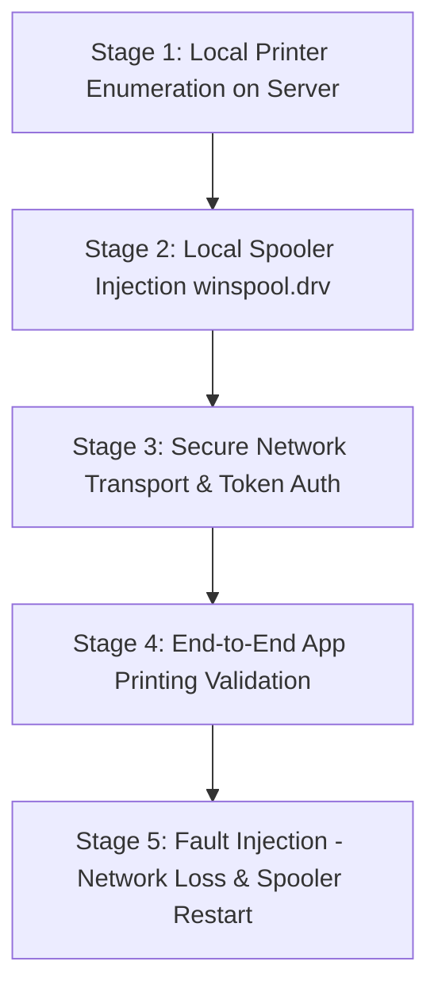

# Proof of Concept (PoC) Test Plan

## L-Net PrintLink — Validation on Two Windows PCs & One Printer

- **Document Version:** v1.0.0
- **Status:** Approved PoC Execution Plan
- **Scope:** Technical validation of end-to-end Windows printer sharing without kernel drivers
- **Target OS:** Windows 10 (19041+) / Windows 11 (21H2+)
- **Date:** 26 October 2026

---

## 1. PoC Objectives & Success Criteria

The purpose of this Proof of Concept (PoC) is to prove the core technical feasibility of PrintLink before proceeding with full UI and installer development. 

### Mandatory Proof Criteria
1. **Local Enumeration:** Server can enumerate all locally installed printers and extract accurate driver, port, and status metadata via `winspool.drv`.
2. **Local Spooler Injection:** Server can successfully inject print data (RAW, PDF, and XPS) into a real local printer using Win32 Spooler APIs (`OpenPrinter`, `StartDocPrinter`, `WritePrinter`).
3. **Secure Network Transport:** Client on PC-B can connect to Server on PC-A over TLS, authenticate via token, and stream print data with flat memory consumption.
4. **End-to-End Windows App Printing:** A user on PC-B can print from an ordinary Windows application (e.g., Notepad, Word, or Edge) through PrintLink to a printer connected to PC-A.
5. **Network Interruption & Recovery:** Pulling the network cable or dropping connection mid-stream transitions the job safely to `Unknown` / `Reconnecting`, recovers automatically upon reconnection, and **never duplicates print jobs**.
6. **Spooler Crash Resilience:** Restarting the Windows Spooler service (`spoolsv.exe`) on PC-A during operation is detected cleanly without crashing the PrintLink background service.

---

## 2. Hardware & Environment Setup

```text
+------------------------------+                     +------------------------------+
|         PC-A (Server)        |                     |         PC-B (Client)        |
| - OS: Windows 10/11 64-bit   |   Local Area Net    | - OS: Windows 10/11 64-bit   |
| - IP: 192.168.1.100          | <=================> | - IP: 192.168.1.101          |
| - Port: TCP 8270 (Open FW)   |    (Switch/WiFi)    | - Software: Word/Notepad/Edge|
+---------------+--------------+                     +------------------------------+
                | USB / LAN
+---------------v--------------+
|     Target Printer (1 Unit)  |
| - Physical: Laser/Thermal/Ink|
| - Fallback: "MS Print to PDF"|
+------------------------------+
```

### Roles and Hardware Requirements
- **PC-A (Server Host):**
  - Windows 10 Pro or Windows 11 Pro.
  - Connected to Target Printer (via USB or dedicated LAN IP).
  - Target Printer Driver installed and verified working locally via Windows Test Page.
- **PC-B (Client Host):**
  - Windows 10 or Windows 11 workstation.
  - Does NOT have the physical printer attached.
- **Target Printer:**
  - 1 unit of physical printer (e.g., HP/Brother/Epson office printer, OR an ESC/POS USB thermal receipt printer).
  - *Baseline Software Fallback:* If a physical printer is temporarily unavailable, `"Microsoft Print to PDF"` or `"Generic / Text Only"` on a virtual port is used to establish baseline spooler P/Invoke behavior.

---

## 3. Step-by-Step PoC Execution Stages



---

### Stage 1: Local Printer Enumeration & Metadata Extraction (PC-A)

- **Goal:** Verify that .NET 10 can query installed Windows printers using P/Invoke `winspool.drv` without relying on high-overhead WMI.
- **Action:**
  1. Execute `EnumPrinters` with `PRINTER_ENUM_LOCAL | PRINTER_ENUM_CONNECTIONS` (Level 2: `PRINTER_INFO_2`).
  2. Extract: `pPrinterName`, `pDriverName`, `pPortName`, `pComment`, `Attributes`, `Status`.
- **Pass Criteria:**
  - Target printer appears in the list with exact driver and port name.
  - Status accurately reports ready/offline states.

---

### Stage 2: Direct Spooler Injection via `winspool.drv` (PC-A)

- **Goal:** Prove that PrintLink can programmatically send raw document streams directly into the Windows Print Spooler.
- **Action:**
  1. Open printer handle via `OpenPrinter(targetPrinterName, out hPrinter, IntPtr.Zero)`.
  2. Initialize `DOC_INFO_1` with `pDocName = "PrintLink_PoC_TestDoc"` and `pDataType = "RAW"`.
  3. Call `StartDocPrinter`, `StartPagePrinter`.
  4. Write test bytes via `WritePrinter` in 64 KB chunks:
     - *Test File A (Office):* Sample 1-page PDF or PostScript/XPS file.
     - *Test File B (POS/Thermal, if applicable):* ESC/POS text string with cut command `\x1B\x40Hello PrintLink!\x0A\x1D\x56\x00`.
  5. Call `EndPagePrinter`, `EndDocPrinter`, `ClosePrinter`.
- **Pass Criteria:**
  - Physical printer prints the test page cleanly or spooler reports job successfully spooled.
  - No handle leaks (`hPrinter` closed cleanly even if an exception is thrown).

---

### Stage 3: Secure Network Transport & Token Authentication (PC-A <-> PC-B)

- **Goal:** Verify secure network communication between client and server over TLS.
- **Action:**
  1. PC-A starts Kestrel server listening on `https://0.0.0.0:8270`.
  2. PC-A generates a 256-bit client token and stores its SHA-256 hash in SQLite.
  3. PC-B initiates HTTPS connection to `https://192.168.1.100:8270/api/v1/health` using `HttpClient`.
  4. PC-B tests authentication:
     - Negative Test: PC-B sends invalid token -> Server returns `HTTP 401 Unauthorized`.
     - Positive Test: PC-B sends valid Bearer token -> Server returns `HTTP 200 OK` with list of shared printers.
  5. PC-B streams a 10 MB test payload via `POST /api/v1/jobs/submit` with `UUIDv7` Job ID.
- **Pass Criteria:**
  - Unauthorized requests are rejected.
  - Authorized payload is received on PC-A in chunks without memory spike on either machine.
  - Server returns immediate ACK with stable `JobId`.

---

### Stage 4: End-to-End Windows Application Printing (PC-B -> PC-A -> Printer)

- **Goal:** Prove that a user on PC-B can print from an ordinary Windows application (Notepad, Word, Edge) to the printer on PC-A.
- **Approaches to Test & Compare in PoC:**
  - **Path A (Embedded IPP 2.0):**
    1. PC-A exposes IPP endpoint `https://192.168.1.100:8270/printers/SharedPrinter1`.
    2. On PC-B, run PowerShell command:
       ```powershell
       Add-Printer -Name "PrintLink_Remote_Printer" `
                   -PortName "https://192.168.1.100:8270/printers/SharedPrinter1" `
                   -DriverName "Microsoft IPP Class Driver"
       ```
    3. Open Notepad on PC-B, write text, click **File -> Print**, select `PrintLink_Remote_Printer`.
  - **Path B (PrintLink Agent Virtual Queue):**
    1. PC-B provisions a local queue using in-box driver (*Microsoft Print to PDF* or *Generic / Text Only*).
    2. PrintLink Client watches local queue or port, captures output file, and transmits via PrintLink API to PC-A.
- **Pass Criteria:**
  - Document printed from Notepad on PC-B outputs correctly onto the printer on PC-A.
  - Latency from click to spool start is under 3.0 seconds on LAN.

---

### Stage 5: Fault Injection & Resilience Testing

- **Goal:** Verify that network dropouts, cable pulls, and spooler crashes are handled gracefully without duplicate printing.

#### Test 5.1: Network Interruption During Transfer
1. Begin streaming a 20 MB print job from PC-B to PC-A.
2. Disconnect Ethernet cable on PC-B at 50% transfer.
3. **Verify:**
   - Client marks job as `Unknown` and server status as `Reconnecting`.
   - Client enters exponential backoff loop with jitter (2s, 4s, 8s...).
4. Reconnect Ethernet cable.
5. **Verify:**
   - Client detects server online, performs status query for `JobId`.
   - Server reports job incomplete/failed.
   - Client prompts user or applies reconciliation policy; **does NOT re-spool duplicate physical pages**.

#### Test 5.2: Server Windows Spooler Crash & Restart
1. On PC-A, while PrintLink Service is running, manually restart Windows Spooler:
   ```powershell
   Restart-Service -Name Spooler -Force
   ```
2. **Verify:**
   - PrintLink Service detects spooler handle invalidation gracefully.
   - Service does not crash.
   - Subsequent print requests recover as soon as Spooler is `Running`.

#### Test 5.3: Duplicate Submission Prevention
1. Submit a print job with `JobId = "0192a6c1-7000-7000-8000-000000000001"`.
2. Re-submit the identical job with the exact same `JobId` within 5 seconds.
3. **Verify:**
   - Server returns the status of the first job (`Accepted` or `Spooling`).
   - Printer prints the document **only once**.

---

## 4. PoC Execution Checklist & Sign-Off Matrix

| Test Case | Description | Expected Result | Actual Result | Status |
| :--- | :--- | :--- | :--- | :--- |
| **TC-01** | Local Printer Enumeration | Lists all installed printers, drivers, ports | Pending PoC code | [ ] |
| **TC-02** | Local `winspool.drv` Spooling | Prints RAW/PDF test stream to local printer | Pending PoC code | [ ] |
| **TC-03** | TLS 1.3 Handshake & Token Auth | Rejects invalid tokens, accepts valid tokens | Pending PoC code | [ ] |
| **TC-04** | Streaming Memory Consumption | Streams large file without OOM (< 50 MB RAM) | Pending PoC code | [ ] |
| **TC-05** | Native Windows App Print | Notepad/Word prints to remote printer | Pending PoC code | [ ] |
| **TC-06** | Cable Pull / Network Recovery | Enters backoff, reconnects, reconciles | Pending PoC code | [ ] |
| **TC-07** | Duplicate Job Idempotency | Identical Job ID printed exactly once | Pending PoC code | [ ] |
| **TC-08** | Windows Spooler Restart | Service survives spooler restart | Pending PoC code | [ ] |

---

## 5. Non-Physical Printer Verification Workaround

If two physical Windows PCs or a physical printer are not immediately available on the development workstation:
1. **Loopback Mode on Single PC:**
   - Host Server on `https://127.0.0.1:8270`.
   - Host Client on the same machine pointing to `127.0.0.1`.
2. **Target Printer Simulation:**
   - Utilize `"Microsoft Print to PDF"` or configure a local virtual port (`PORTPROMPT:`) to verify binary spooling through `winspool.drv` into an output file.
3. This allows 90% of the P/Invoke, serialization, network, and state-machine logic to be validated automatically in automated tests before physical 2-PC lab testing.
