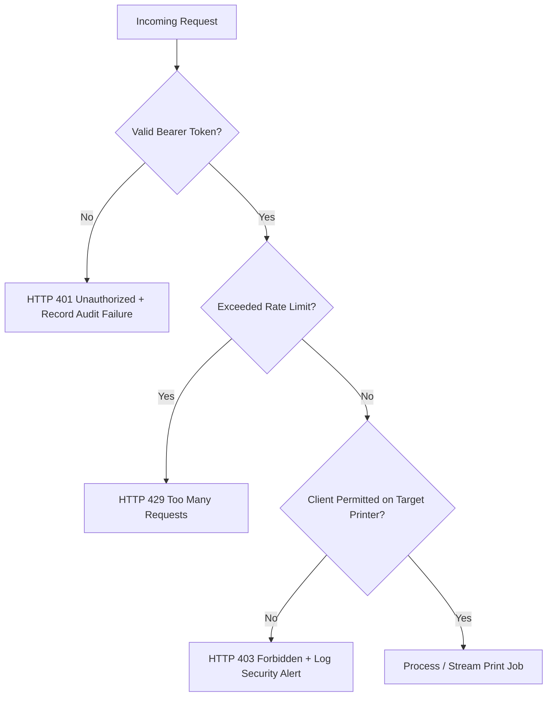

# Security Architecture & Threat Model

## L-Net PrintLink — Windows Printer Sharing & Reliability

- **Version:** v1.0.0
- **Status:** Approved Security Specification
- **Target OS:** Windows 10 (19041+) / Windows 11 (21H2+)
- **Date:** 26 October 2026

---

## 1. Security Philosophy & Principles

PrintLink treats network printer sharing as a security-critical operational surface. Windows print subsystems have historically been vulnerable to remote code execution and elevation of privilege (e.g., PrintNightmare CVE-2021-34527, CVE-2021-1675). PrintLink is architected with strict defensive engineering:

1. **Zero Trust in Local Area Networks (LAN):** LAN traffic is not inherently trusted. All control commands, status heartbeats, and document payloads are encrypted in transit.
2. **Zero Plaintext Secrets:** Passwords, API tokens, and private keys are never stored in plaintext on disk, in databases, or in memory dumps.
3. **Least Privilege Execution:** Background services and UI applications run with the minimal Windows privileges necessary for operation.
4. **Zero Document Retention:** Print documents are sensitive customer/business data. Document bytes are spooled directly into Windows Print Spooler and immediately discarded from memory and temporary storage.
5. **Fail-Closed Authorization:** Any unauthenticated or unauthorized request is immediately rejected, logged to the security audit trail, and subject to rate-limiting.

---

## 2. Threat Model (STRIDE Analysis)

| Threat Category | Potential Attack Vector | PrintLink Defensive Mitigation |
| :--- | :--- | :--- |
| **Spoofing** | Rogue machine impersonating a legitimate PrintLink Server to intercept documents. | Client verifies Server TLS certificate against pinned certificate thumbprint or trusted local CA before transmitting credentials. |
| **Spoofing** | Unauthorized client forging identity to access restricted printers. | High-entropy 256-bit cryptographically secure tokens. Server validates SHA-256 token hashes and active status before granting access. |
| **Tampering** | Attacker modifying print document stream or control payload in transit. | Mandatory TLS 1.3 / 1.2 with AEAD ciphers (`AES_GCM`, `CHACHA20_POLY1305`) guarantees payload integrity. |
| **Tampering** | Malicious local user altering SQLite configuration or log files on disk. | Restrictive Windows NTFS Access Control Lists (ACLs) on `%ProgramData%\LNet\PrintLink`. Only Administrators and Service account have write access. |
| **Repudiation** | User or client denies submitting a sensitive or unauthorized print job. | Append-only SQLite audit log recording Client ID, IP, Friendly Name, Printer Share, Timestamp, and Spooler Job ID. |
| **Information Disclosure**| Eavesdropping on print documents or user credentials across the network. | All traffic encrypted over TLS. Tokens are hashed at rest. Document payloads are streamed via memory chunks and never persisted to logs. |
| **Denial of Service** | Flooding the server with gigantic print payloads or endless connection attempts. | Configurable maximum job size (Default: 50 MB); stream throttling (64 KB chunks); rate-limiting on failed auth (5 failures = 5-minute IP lockout). |
| **Elevation of Privilege**| Exploiting the background Windows Service to execute arbitrary code as SYSTEM. | Service runs under dedicated virtual account `NT SERVICE\PrintLinkService`. Strictly no execution of external processes or untrusted shell commands. |

---

## 3. Cryptographic & Credential Management

### 3.1 Credential Storage at Rest
Under no circumstances are plaintext tokens or passwords stored in configuration files or database tables.

```text
[ Client Token Generation ]
  Cryptographic Random (32 bytes) -> Base64 URL Token (Client-side)
  Token Hash: SHA-256(Token + ServerSalt) -> Stored in SQLite (Server-side)
```

1. **Server Storage:**
   - Client tokens are hashed using SHA-256 with a unique server salt: `HMAC-SHA256(ClientToken, MasterSalt)`. Only the resulting hash is stored in `AuthorizedClients` table.
   - Master Salt and Server Private Keys are encrypted using **Windows DPAPI** (`DataProtectionScope.LocalMachine`):
     ```csharp
     byte[] encryptedSalt = ProtectedData.Protect(
         masterSaltBytes, 
         entropyBytes, 
         DataProtectionScope.LocalMachine);
     ```
2. **Client Storage:**
   - The client stores its authentication tokens using Windows DPAPI (`DataProtectionScope.CurrentUser` for desktop settings or `DataProtectionScope.LocalMachine` for service credentials).
   - Alternatively, Windows Credential Manager (`wincred.dll`) is utilized for user-interactive credentials.

---

## 4. Transport Layer Security (TLS) Policy

- **Protocols Supported:** TLS 1.3 (preferred), TLS 1.2 (minimum). Legacy protocols (SSL 2.0, SSL 3.0, TLS 1.0, TLS 1.1) are explicitly disabled in Kestrel server configuration.
- **Cipher Suites:** Restricted to secure AEAD suites:
  - `TLS_AES_256_GCM_SHA384`
  - `TLS_CHACHA20_POLY1305_SHA256`
  - `TLS_AES_128_GCM_SHA256`
  - `TLS_ECDHE_ECDSA_WITH_AES_256_GCM_SHA384`
  - `TLS_ECDHE_RSA_WITH_AES_256_GCM_SHA384`

### Certificate Management Options
1. **Self-Signed with Pinned Thumbprint (Default for Small Office):**
   - First-run wizard generates a dedicated self-signed X.509 certificate (RSA 4096-bit or ECDSA P-384, validity 2 years).
   - The Client setup UI prompts the user to verify the Server Certificate Thumbprint (Fingerprint) during first connection, storing the trusted thumbprint in the client database.
2. **Enterprise CA / Custom Certificate:**
   - Administrators can import an existing certificate from the Windows Certificate Store (`Cert:\LocalMachine\My`).

---

## 5. Authorization & Access Control

Access control is evaluated at every API boundary:



### Authorization Rules
1. Each shared printer maintains an explicit ACL:
   - `AllowedClientsJson = ["*"]` (Public to all authenticated clients), OR
   - `AllowedClientsJson = ["client-uuid-1", "client-uuid-2"]` (Restricted).
2. Revocation takes effect immediately without requiring service restart:
   - Setting `IsRevoked = 1` immediately invalidates token evaluation in memory cache.

---

## 6. Windows Firewall & Network Configuration

- **Default Port:** TCP `8270` (Configurable by Administrator).
- **Network Interface Binding:**
  - Default: Bind to private LAN adapters (`192.168.x.x`, `10.x.x.x`, `172.16.x.x`) or loopback (`127.0.0.1`).
  - **No Exposure to Public Internet:** Default configuration prohibits binding to public-facing network interfaces without administrative override.
- **Firewall Policy:**
  - PrintLink does not silently modify Windows Firewall rules.
  - The installer or First-Run Wizard provides an explicit prompt with exact PowerShell / `netsh` commands for administrator approval:
    ```powershell
    New-NetFirewallRule -Name "PrintLink_Server" `
                        -DisplayName "L-Net PrintLink Service (Inbound)" `
                        -Direction Inbound `
                        -Protocol TCP `
                        -LocalPort 8270 `
                        -Action Allow `
                        -Profile Private,Domain
    ```

---

## 7. Least Privilege & Windows Process Isolation

1. **Windows Service Account:**
   - The background service (`PrintLink.Service`) is configured to run under a dedicated virtual service account: `NT SERVICE\PrintLinkService` or `NT AUTHORITY\LocalService`.
   - The service is granted only:
     - `SeChangeNotifyPrivilege` (filesystem change notifications).
     - Full Control over `%ProgramData%\LNet\PrintLink`.
     - Standard user-mode access to Windows Print Spooler (`winspool.drv`).
   - Running as `NT AUTHORITY\SYSTEM` is strictly avoided unless hardware-specific printer driver isolation demands elevated permissions (which must be explicitly documented and opt-in).
2. **Desktop GUI Process:**
   - `PrintLink.Desktop` runs as a standard desktop user process (`requestedExecutionLevel level="asInvoker"`).
   - It communicates with the background service via local Named Pipes with Windows Access Control Lists:
     - `Authenticated Users`: Read status and job lists.
     - `Administrators`: Configure settings, restart service, manage client tokens.

---

## 8. Logging, Audit Trail, & Diagnostics Scrubbing Policy

To balance deep troubleshooting capabilities with strict privacy and security standards:

### What Is Always Logged
- Timestamps, log severity, thread IDs, diagnostic reference IDs.
- Connection events: Client IP, Client ID, TLS handshake completion, disconnection events.
- Job lifecycle state transitions (`Queued`, `Sending`, `Accepted`, `Spooling`, `Completed`, `Failed`, `Unknown`).
- Windows Spooler error codes (Win32 error numbers).
- Security events: Failed logins, token revocations, ACL violations.

### What Is Strictly NEVER Logged
- **Document Payload:** Raw print data (binary stream, postscript, PCL, XPS, PDF) is NEVER written to log files.
- **Document Names (Configurable Masking):** Document titles can be anonymized in logs (e.g., `Document_****_A1B2.pdf`).
- **Secrets:** Passwords, API tokens, bearer headers, private keys, DPAPI entropy bytes.

### Sanitized Diagnostic Bundle Export
When an administrator clicks **"Export Diagnostic Bundle"**:
1. The bundle generation engine reads the latest rotating log files.
2. A sanitization pipeline executes regex replacements on any potential sensitive patterns (IP addresses can be optionally masked, bearer tokens scrubbed).
3. The SQLite database is exported with the `AuthorizedClients.TokenHash` column replaced with `[REDACTED]`.
4. Output is packaged as a standard encrypted or password-protected ZIP for support analysis.
